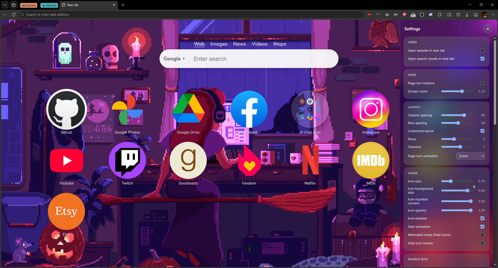
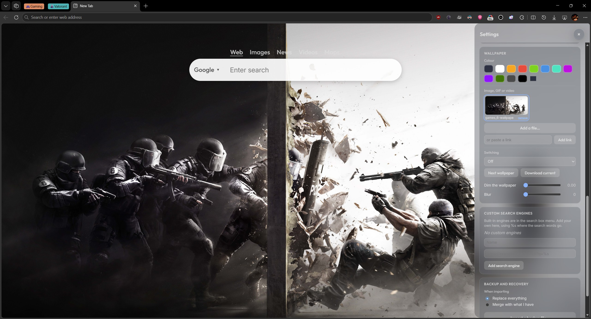
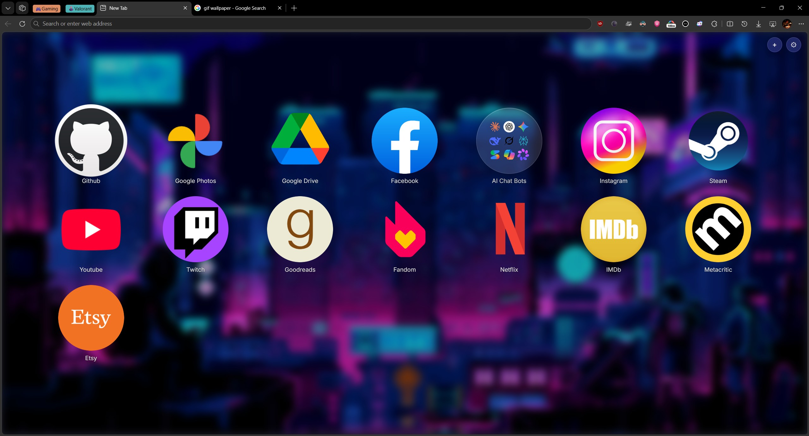
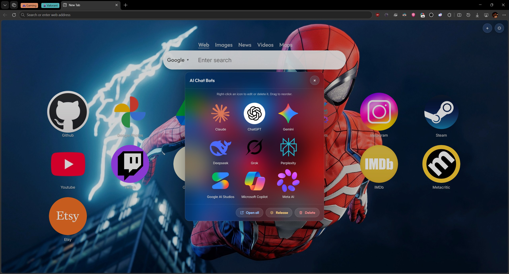

<p align="center">
    <picture>
      
    </picture>
  </a>
</p>

<h1 align="center">NewGrid</h1>

A local-only Chrome/Edge/Firefox new tab extension which allows for a grid-based layout of your favourite websites. No accounts, backup locally. Everything lives in `chrome.storage.local` and IndexedDB.

## Install

### Chrome / Edge

1. Open `chrome://extensions` (or `edge://extensions`) and turn on Developer mode.
2. Click **Load unpacked** and select this folder.
3. Open a new tab.

### Firefox

1. Install from [addons.mozilla.org](https://addons.mozilla.org/en-US/firefox/addon/newgrid/), or load it temporarily:
2. Open `about:debugging#/runtime/this-firefox`, click **Load Temporary Add-on…** and pick `release/NewGrid-x.y.z-firefox.xpi`.
3. Open a new tab.

Temporary add-ons are removed when Firefox closes, and a new-tab override loaded this way resets between sessions — for daily use, install the signed version from AMO.

<p align="center">
<table>
<tr>
<td><a href="https://chromewebstore.google.com/detail/newgrid/blmoejlifahndadkjaiogklgbgfifoca">
</img>
</a>
<td><a href="https://addons.mozilla.org/en-US/firefox/addon/newgrid/">
</img>
</a>
</tr>
<table>
</p>

# Screenshots

<table>
<tr>
<th>Full View</th>
<th>Minimal View</th>
</tr>
  <tr>
    <td></td>
    <td></td>
  </tr>
<tr>
<th>No Seach Box</th>
<th>Folder</th>
</tr>
  <tr>
    <td></td>
    <td></td>
  </tr>
</table>

## Firefox support

Firefox is supported through a build of the same source. `node scripts/make-firefox.mjs` reads the Chrome `manifest.json` and writes a Gecko-adapted manifest into the package, producing `release/NewGrid-x.y.z-firefox.zip` and an identical `.xpi` (the zip is the one you upload to [AMO](https://addons.mozilla.org/developers/); validate it first with `npx web-ext lint --source-dir <extracted zip>`).

Differences from the Chrome build:

| Chrome (MV3) | Firefox (Gecko) |
| --- | --- |
| `background.service_worker` | `background.scripts` event page |
| `minimum_chrome_version: "105"` | removed |
| `unlimitedStorage` permission | removed (Firefox has no storage quota to lift) |
| extension ID from the CRX signing key | fixed Gecko ID `{e5ad6c4e-e78e-4644-80c1-726eadd24e04}` |
| — | `data_collection_permissions: required: ["none"]` (AMO requirement; see [PRIVACY.md](PRIVACY.md)) |

The Firefox build requires Firefox 142 or later — the first release where `data_collection_permissions` is supported on both desktop and Android. The add-on ID must never change between releases, or Firefox will treat updates as a different extension.

## Features

| Area | What works |
| --- | --- |
| Icon grid | Pages of icons, dots and arrows, wheel and keyboard paging, drag to reorder, drag onto an icon to make a folder, drag onto a folder to add to it, right-click to edit |
| Icon sizing | **Icon size** scales the glyph (favicon or letter). **Icon background size** scales the tile. **Icon rounded corners** goes from square to a full circle |
| Grid layout | Default 3 × 6. With **Customize layout** on you control rows, columns, column spacing and row spacing (0 to 160 px each) |
| Folders | Flip-open dialog, rename, open all, release and delete (both confirmed). The dialog shows up to 6 × 4 icons and scrolls beyond that. The tile shows the first nine icons in a centred 3 × 3 grid at 80% size |
| Sites | Add (URL, name, favicon, or colour and two-letter text, or a custom image up to 2 MB), edit, delete |
| Settings | A right-side panel that slides in from the cog. Each group is its own card: Links, View, Layout, Icons, Search box, Font, Wallpaper, Custom search engines, Permissions, Backup |
| Search | Built-in engines (Google, Bing, DuckDuckGo, Yahoo, Baidu, Yandex, Sogou, 360) in the engine menu. Result types (Web, Images, News, Videos, Maps) appear above the search box. Custom engines with `%s` are added in Settings. Box size can go from half to four times the default |
| Icon editor | Website icon, image, or text. Drag to position, zoom out or in, and the faded parts show what will be hidden. Tile background colour (including transparent) |
| Fonts | Outfit for headings and buttons, Inter for everything else |
| Page turn | Nine animations: slide, slide ease-in, kick back, fade, zoom, flip, carousel, drop, blur |
| Wallpaper | Solid colour, or a local image, GIF or video file (files are stored in IndexedDB, up to 40 MB for images and 300 MB for video), or a link to an image, GIF or video. Scheduled switching, dim and blur. Videos pause when the tab is hidden |
| Backup | Export everything to JSON, import with overwrite or merge, restore default settings |

## Project layout

```text
manifest.json            MV3 manifest (newtab override, popup, service worker)
background.js            service worker: imports the first-run defaults on install
shared/                  pure logic used by the pages and tests
  defaults.js            storage keys, default settings, built-in engines, starter icons
  settings.js            merge defaults, apply a change, effective grid geometry
  sites.js               page and folder model: move, merge, release, delete, normalise
  search.js              engine lookup and %s templates
  blobstore.js           IndexedDB for wallpaper files
  icons.js               website icon engine (Google favicon service through an img tag)
  storage.js             chrome.storage.local helpers
  util.js                DOM helpers, URL normalising, file and permission helpers
newtab/
  index.html, newtab.css
  js/app.js              boot, search bar, wallpaper and grid wiring, keyboard
  js/grid.js             icon grid, drag and drop, folder dialog, editor
  js/drawer.js           the settings side panel and all its cards
  js/wallpaper.js        wallpaper files, links, switching and playback
  js/icon-editor.js      icon editor: website icon, image or text, with crop preview
  js/confirm.js          in-page confirmation dialog
  js/launcher.js         what an icon does when opened
  js/context.js          shared state and store load/save
popup/popup.html, popup.js   add current page
tests/sites.test.mjs     unit tests for the model and settings (node --test)
tests/e2e-smoke.mjs      browser test that loads the extension and clicks through it
tests/e2e-features.mjs   browser test for wallpaper, icon editor and page turns
tests/screenshots.mjs    takes screenshots of the main states into ./screenshots
scripts/make-icons.mjs   generates placeholder PNG icons
scripts/make-firefox.mjs builds the Firefox package (zip + xpi) into release/
```

## Develop and test

```powershell
npm install
npm test               # unit tests for the page and folder model and settings
npm run check          # syntax check of every entry module
npx eslint .           # lint
node tests/e2e-smoke.mjs   # loads the unpacked extension in a real browser
node tests/e2e-features.mjs  # wallpaper library, custom icons, icon editor, page turns
node tests/screenshots.mjs # writes screenshots to ./screenshots
node scripts/make-firefox.mjs  # builds release/NewGrid-<version>-firefox.zip and .xpi
```

The browser tests use `puppeteer-core`. Chrome 137+ branded builds removed `--load-extension`, so the tests default to Microsoft Edge. Set `CHROME_PATH` to another Chromium build that still supports it, such as Chrome for Testing.

## License

MIT. See [LICENSE](LICENSE).

## Notes
- `default.json` (a backup file) is imported silently the first time the extension is installed. It runs once, and only on a fresh install. Replace the file to change what new users start with. `tests/e2e-first-run.mjs` checks it.
- Storage keys: `store-site`, `store-setting`, `store-search`, `store-bookmarks`, `store-wallpaper`.
- `unlimitedStorage` is requested because wallpaper files live in IndexedDB (Chrome only; Firefox has no quota to lift).
- Icons are plain placeholders. Replace `icons/*.png` before distributing.
- Cross-browser notes: `popup.js` opens the right new-tab page per browser (`chrome://newtab` vs `about:newtab`), and `launcher.js` guards `chrome.management` (Chromium-only) with a toast fallback on Firefox.
